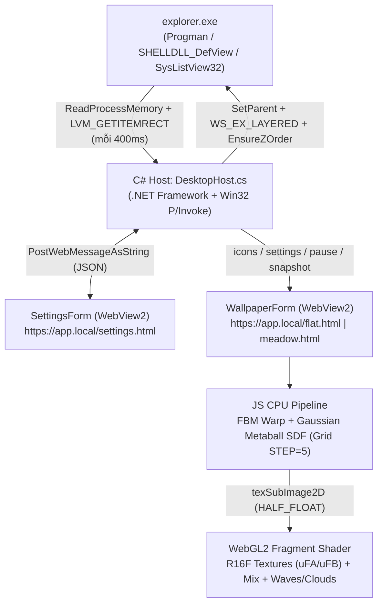

# Phân Tích Toàn Diện Cơ Chế Hoạt Động Của Deskland

Tài liệu tổng hợp toàn bộ kiến thức về sản phẩm, kiến trúc hệ thống, cơ chế Win32, thuật toán đồ họa thích ứng theo icon và các kỹ thuật tối ưu hóa của **Deskland** (https://deskland.app/), dựa trên phân tích thông tin chính thức và mã nguồn mở tại [BLEZZ0102/Deskland](https://github.com/BLEZZ0102/Deskland) (giấy phép GPL-3.0).

---

## Mục Lục

1. [Tổng quan sản phẩm & Các phiên bản](#1-tổng-quan-sản-phẩm--các-phiên-bản)
2. [Kiến trúc tổng thể & Cấu trúc mã nguồn](#2-kiến-trúc-tổng-thể--cấu-trúc-mã-nguồn)
3. [Cơ chế 1: Nhúng cửa sổ hình nền vào sau lớp Icon Desktop (Windows 10 / 11 & 24H2+)](#3-cơ-chế-1-nhúng-cửa-sổ-hình-nền-vào-sau-lớp-icon-desktop)
4. [Cơ chế 2: Đọc tọa độ Icon thời gian thực xuyên tiến trình (`IconReader`)](#4-cơ-chế-2-đọc-tọa-độ-icon-thời-gian-thực-xuyên-tiến-trình)
5. [Cơ chế 3: Giao tiếp 2 chiều Host ↔ WebView2 (IPC Protocol)](#5-cơ-chế-3-giao-tiếp-2-chiều-host--webview2)
6. [Cơ chế 4: Thuật toán dựng địa hình thích ứng (Gaussian Metaball SDF + Domain Warping + WebGL2)](#6-cơ-chế-4-thuật-toán-dựng-địa-hình-thích-ứng)
7. [Cơ chế 5: Thực thể động, Lớp phụ & Tối ưu 30 FPS trên iGPU](#7-cơ-chế-5-thực-thể-động-lớp-phụ--tối-ưu-30-fps-trên-igpu)
8. [Cơ chế 6: Tự động tạm dừng (Auto-Pause) & Quản lý vòng đời](#8-cơ-chế-6-tự-động-tạm-dừng-auto-pause--quản-lý-vòng-đời)
9. [Cơ chế 7: Quyền riêng tư & Chia sẻ ảnh/video không lộ dữ liệu thật](#9-cơ-chế-7-quyền-riêng-tư--chia-sẻ-ảnhvideo-không-lộ-dữ-liệu-thật)
10. [Cấu hình Build, Manifest, CLI & Lưu trữ dữ liệu](#10-cấu-hình-build-manifest-cli--lưu-trữ-dữ-liệu)
11. [Các "bẫy" kỹ thuật (Gotchas) & Bài học nếu tự xây dựng lại](#11-các-bẫy-kỹ-thuật-gotchas--bài-học-nếu-tự-xây-dựng-lại)

---

## 1. Tổng quan sản phẩm & Các phiên bản

**Deskland** là ứng dụng hình nền động thích ứng (**adaptive live wallpaper**) cho **Windows 10/11 (64-bit)**. Khác với Wallpaper Engine (phát video lặp hoặc scene tĩnh tách biệt với icon), Deskland đọc tọa độ các biểu tượng trên desktop để tự động tính toán và uốn nắn cảnh quan (bờ biển, sóng, đảo cát, đám mây, bóng cây, hồ cá...) bao quanh icon theo thời gian thực.

- **Không dùng AI tạo sinh (Generative AI)**, không cần API key, không cần tài khoản, chạy 100% cục bộ bằng toán học và shader.
- **Các phiên bản:**
  - **Base / Preview Edition (Miễn phí, mã nguồn mở trên GitHub):** Gồm 2 theme hoàn chỉnh (*Beach* — Bãi biển và *Meadow* — Đồng cỏ), không quảng cáo, không giới hạn thời gian; các theme còn lại hiển thị dạng preview có khóa.
  - **Wallpaper Edition (khoảng \$4.99, mua 1 lần):** Mở khóa thư viện hơn 13 theme (Maldives, Colorful City, Hand Draw City, Forest, Pink Forest, Lake, Lotus, Nautical Chart, Ocean, Old Map, Sky...), phát hành qua trang chủ, Microsoft Store và Steam.
  - **Game Edition (định hướng mở rộng):** Bổ sung tính năng tương tác sâu, sưu tầm và xây dựng ngay trên nền desktop.

---

## 2. Kiến trúc tổng thể & Cấu trúc mã nguồn

Deskland sử dụng kiến trúc **Hybrid Native + Local Web**:
- **Native Host (C# / .NET Framework):** Chịu trách nhiệm tương tác sâu với Win32 API (nhúng vào desktop, đọc bộ nhớ Explorer để lấy tọa độ icon, theo dõi cửa sổ toàn màn hình, khay hệ thống, phím tắt toàn cục, khởi động cùng Windows).
- **Rendering Engine (WebView2 — Chromium):** Chạy các trang HTML/JS/WebGL2 cục bộ thông qua ánh xạ tên miền ảo (`app.local`), cho phép cập nhật/sửa giao diện theme mà không cần biên dịch lại tệp thực thi `.exe`.



### Cấu trúc thư mục chính của dự án mở (`BLEZZ0102/Deskland`)

| Đường dẫn | Vai trò |
| --- | --- |
| `host/DesktopHost.cs` | Toàn bộ logic ứng dụng Windows: `Program`, `HostContext`, `SettingsForm`, `WallpaperForm`, `IconReader`, `HotkeyWindow`, `Native` (P/Invoke), `Settings`, `I18n`. |
| `host/Themes.cs` | Định nghĩa/đọc metadata chủ đề phía host. |
| `host/app.manifest` | Khai báo `PerMonitorV2` DPI Awareness và tương thích Windows 8–11 (bắt buộc cho `WS_EX_LAYERED` trên cửa sổ con). |
| `host/build.ps1` | Script PowerShell tự tải NuGet `Microsoft.Web.WebView2` phiên bản cố định và build ra `host/bin/Deskland.exe` bằng trình biên dịch `csc.exe` có sẵn của Windows. |
| `prototype/themes.json` | Danh sách theme, trạng thái (`ready`/locked), nhóm tham số tùy chỉnh (`sigma`, `warp`, `shoal`, `cover`, `flow`...) và giá trị mặc định. |
| `prototype/flat.html` | Theme **Beach** (WebGL2 shader sóng/bờ biển + thuyền kayak + chim biển + dừa). |
| `prototype/beach-palms.js` | Logic đặt và vẽ cây dừa cục bộ quanh vùng cát an toàn. |
| `prototype/meadow.html` | Theme **Meadow** (WebGL2 đám mây bao quanh icon + bóng mây trên đồng cỏ + mây trôi tự do). |
| `prototype/meadow-boy.js`, `meadow-cat.js` | Các thực thể nhân vật cục bộ (cậu bé thả diều, mèo đen) vẽ tách lớp để giảm tải shader. |
| `prototype/settings.html` | Giao diện cài đặt (nhúng iframe preview `?preview=1`). |
| `prototype/share.js` | Cơ chế chụp ảnh / quay video chia sẻ an toàn bằng icon giả lập. |
| `prototype/serve.mjs` | Server Node.js cục bộ (`http://localhost:5178/settings.html`) để phát triển & debug theme trực tiếp trên trình duyệt. |
| `tools/installer.nsi` | Script đóng gói bộ cài đặt Windows x64 bằng NSIS. |

---

## 3. Cơ chế 1: Nhúng cửa sổ hình nền vào sau lớp Icon Desktop

Để hình nền động nằm **phía sau các icon desktop** nhưng **phía trên hình nền tĩnh gốc** và không chặn thao tác chuột lên icon, Deskland xử lý 2 nhánh kiến trúc cửa sổ của Windows:

### A. Windows 10 và Windows 11 trước 24H2 (Cơ chế `WorkerW` cổ điển)
1. Tìm cửa sổ gốc `Progman` bằng `FindWindow("Progman", null)`.
2. Gửi thông điệp không chính thức `0x052C` tới `Progman`:
   ```csharp
   SendMessageTimeout(progman, 0x052C, new IntPtr(0xD), new IntPtr(1), 0, 1000, out res);
   ```
   Thông điệp này buộc Explorer tách lớp vẽ hình nền ra một cửa sổ `WorkerW` riêng biệt nằm ngay sau cửa sổ chứa `SHELLDLL_DefView` (lớp icon).
3. Duyệt toàn bộ cửa sổ cấp cao (`EnumWindows`) để tìm cửa sổ chứa `SHELLDLL_DefView`, sau đó tìm cửa sổ `WorkerW` nằm ngay kế tiếp nó (`FindWindowEx(IntPtr.Zero, host, "WorkerW", null)`).
4. Gọi `SetParent(wallpaperHwnd, workerW)` và căn kích thước khớp màn hình bằng `SetWindowPos`.

### B. Windows 11 24H2 trở đi ("Raised Desktop" — Điểm kỹ thuật quan trọng)
Trên Windows 11 24H2+, cấu trúc cây cửa sổ của Desktop thay đổi: `Progman` trực tiếp chứa cả 2 cửa sổ con là `SHELLDLL_DefView` (icon ở trên) và `WorkerW` (hình nền hệ thống ở dưới).
- **Vấn đề của cách cũ (`--legacy`):** Nếu gắn vào `WorkerW`, mỗi khi người dùng hoặc Windows đổi hình nền (Slideshow / Windows Spotlight), Explorer sẽ **hủy và tạo mới `WorkerW`**, làm cửa sổ ứng dụng bị hủy theo.
- **Vấn đề nếu gắn vào `SHELLDLL_DefView` (`--defview`):** Thử nghiệm thực tế cho thấy WebView2 không thể vẽ lên bề mặt của `SHELLDLL_DefView`.
- **Giải pháp mặc định của Deskland (`AttachMode = "progman"`):**
  1. Gắn `WallpaperForm` làm cửa sổ con trực tiếp của `Progman`: `SetParent(Handle, progman)`.
  2. Vì `Progman` không cung cấp bề mặt vẽ cho cửa sổ con thông thường, Deskland biến `WallpaperForm` thành **cửa sổ con phân lớp (Layered Child Window)**:
     ```csharp
     SetWindowLong(Handle, GWL_EXSTYLE, ex | WS_EX_LAYERED);
     SetLayeredWindowAttributes(Handle, 0, 255, LWA_ALPHA);
     ```
     *(Lưu ý: `WS_EX_LAYERED` kết hợp `WS_CHILD` chỉ hoạt động nếu `app.manifest` khai báo `<supportedOS>` cho Windows 8–11).*
  3. Chèn Z-order của `WallpaperForm` nằm ngay sau `SHELLDLL_DefView` (`zAnchor = defView`):
     ```csharp
     SetWindowPos(Handle, zAnchor, pt.X, pt.Y, screen.Width, screen.Height, ...);
     ```
  4. **Giữ vững Z-Order khi hệ thống đổi hình nền:**
     - Đăng ký `SetWinEventHook` theo dõi sự kiện cửa sổ trên tiến trình của `Progman`.
     - Mỗi khi Explorer tạo lại hoặc sắp xếp lại `WorkerW` (vốn hay chen lên trên `WallpaperForm`), hàm `EnsureZOrder()` lập tức đưa `WallpaperForm` về lại ngay dưới `zAnchor` và đẩy tất cả các `WorkerW` con của `Progman` xuống dưới cùng (`HWND_BOTTOM = 1`).

### C. Thoát sạch và khôi phục hệ thống (`Shutdown`)
- `WallpaperForm` ghi đè `ShowWithoutActivation => true` để khi khởi động tuyệt đối không cướp focus của cửa sổ đang làm việc.
- Khi thoát ứng dụng: dừng timer, gỡ `WinEventHook`, gọi `SetParent(Handle, IntPtr.Zero)`, ẩn cửa sổ và gọi `RedrawWindow(parent, ...)` để Explorer vẽ lại hình nền gốc ngay lập tức mà **không sửa đổi cài đặt hình nền hệ thống** (Slideshow/Spotlight vẫn giữ nguyên).

---

## 4. Cơ chế 2: Đọc tọa độ Icon thời gian thực xuyên tiến trình

Lớp icon trên Windows Desktop là một control `SysListView32` nằm trong `SHELLDLL_DefView`, chạy trong không gian bộ nhớ của `explorer.exe`. Do cơ chế cách ly bộ nhớ giữa các tiến trình, bạn không thể truyền con trỏ `RECT*` từ tiến trình C# sang `SendMessage` của `explorer.exe`.

Deskland giải quyết bằng lớp `IconReader` sử dụng kỹ thuật **cấp phát bộ nhớ chéo tiến trình**:

1. **Định vị `SysListView32`:**
   - Tìm `SHELLDLL_DefView` bên trong `Progman`; nếu không có (Windows cũ) thì `EnumWindows` tìm cửa sổ nào chứa `SHELLDLL_DefView`.
   - Lấy handle con `SysListView32` bên trong `SHELLDLL_DefView`.
2. **Mở tiến trình & Cấp phát bộ nhớ đệm:**
   - Lấy PID từ `GetWindowThreadProcessId(listView, out pid)`.
   - Gọi `OpenProcess(PROCESS_VM_OPERATION | PROCESS_VM_READ | PROCESS_VM_WRITE, false, pid)` (`0x0008 | 0x0010 | 0x0020`).
   - Gọi `VirtualAllocEx(proc, IntPtr.Zero, 64, MEM_COMMIT | MEM_RESERVE, PAGE_READWRITE)` để xin 64 byte ngay trong bộ nhớ của `explorer.exe`.
3. **Chu kỳ quét mỗi 400ms (`PollIcons`):**
   - Kiểm tra `IsWindowVisible(listView)`. Nếu người dùng tắt "Show desktop icons", trả về mảng rỗng (`vis: false`) → địa hình rút hết đảo, toàn màn hình trở thành biển/đồng cỏ trống.
   - Gửi `LVM_GETITEMCOUNT` (`0x1004`) để lấy số lượng icon `count`.
   - Gọi `ClientToScreen(listView, ref origin)` để lấy độ lệch tọa độ client → màn hình.
   - Lặp `i = 0 .. count - 1`:
     - Khởi tạo `RECT r` với `r.Left = 0` (`LVIR_BOUNDS`: lấy hình chữ nhật bao trọn cả **biểu tượng lẫn tên file**).
     - Ghi 16 byte của `r` vào địa chỉ `mem` trong `explorer.exe` bằng `WriteProcessMemory`.
     - Gửi `SendMessage(listView, 0x100E /* LVM_GETITEMRECT */, i, mem)` — Explorer sẽ điền tọa độ `Left, Top, Right, Bottom` (đơn vị pixel vật lý) vào chính vùng nhớ `mem`.
     - Đọc ngược 16 byte kết quả ra bằng `ReadProcessMemory`.
     - Cộng `origin.X`, `origin.Y` rồi trừ tọa độ góc trên-trái của màn hình (`screen.X`, `screen.Y`).
4. **Chống gửi thừa (Diffing):**
   - Nối thành chuỗi JSON: `{"t":"icons","vis":true,"r":[[l,t,r,b],...]}`.
   - So sánh chuỗi với `lastIcons`. Chỉ khi có thay đổi (kéo thả, thêm, xóa, ẩn/hiện icon) mới gọi `PostWebMessageAsString` sang WebView2.

> **Lưu ý về DPI:** Vì `app.manifest` khai báo `PerMonitorV2`, tọa độ nhận được từ `SysListView32` là **pixel vật lý chuẩn xác**, không bị Windows ảo hóa/scale sai lệch ở mức 125%/150%.

---

## 5. Cơ chế 3: Giao tiếp 2 chiều Host ↔ WebView2

Cả trang cài đặt (`settings.html`) lẫn trang hình nền (`flat.html`, `meadow.html`) đều được nạp từ thư mục cục bộ thông qua ánh xạ tên miền ảo của WebView2:

```csharp
core.SetVirtualHostNameToFolderMapping("app.local", pageDir, CoreWebView2HostResourceAccessKind.Allow);
```

Thư mục lưu file chia sẻ được ánh xạ riêng sang `share.local`. Nhờ đó WebView2 tránh được các giới hạn bảo mật CORS/WebGL của giao thức `file://`.

### 3 chế độ hoạt động của cùng một tệp HTML theme
Mỗi trang theme (`flat.html`, `meadow.html`) tự nhận diện môi trường để hoạt động linh hoạt:
1. **Chế độ Hình nền thật (Host WebView2):** Nhận tin nhắn qua `window.chrome.webview`, ẩn UI debug và thanh taskbar giả.
2. **Chế độ Xem trước (`?preview=1`):** Chạy trong `<iframe>` của `settings.html`, giao tiếp qua `window.postMessage`, bỏ qua lệnh `pause` để người dùng luôn thấy ảnh động khi chỉnh thanh trượt.
3. **Chế độ Prototype trên trình duyệt (`node prototype/serve.mjs`):** Hiển thị các icon desktop giả có thể kéo thả tự do kèm bảng slider debug.

### Các loại thông điệp chính (JSON)

| Hướng giao tiếp | Loại tin nhắn (`t`) | Mục đích |
| --- | --- | --- |
| Theme → Host | `ready` | Báo WebView2 đã khởi tạo xong; Host lập tức đẩy `settings` và `icons` ban đầu xuống. |
| Host → Theme | `icons` | Gửi trạng thái hiển thị (`vis`) và mảng tọa độ `[[l,t,r,b], ...]`. |
| Host → Theme | `settings` / `reset` | Cập nhật từng tham số theme theo thời gian thực hoặc khôi phục mặc định. |
| Host → Theme | `pause` | Bật/tắt trạng thái tạm dừng (`v: true/false`). |
| Host → Theme | `snapshot` / `record` | Yêu cầu trang theme xuất ảnh tĩnh PNG hoặc quay video chia sẻ. |
| Settings → Host | `hello`, `set`, `reset`, `theme`, `lang`, `autostart` | Đồng bộ cấu hình, chuyển theme, đổi ngôn ngữ, bật/tắt khởi động cùng Windows. |

---

## 6. Cơ chế 4: Thuật toán dựng địa hình thích ứng

Đây là trái tim đồ họa của Deskland. Thay vì tính khoảng cách tới hàng chục icon ở từng pixel trên Fragment Shader (rất nặng cho GPU tích hợp), Deskland tách việc tính toán thành **2 giai đoạn: CPU Coarse Grid + GPU Shader Interpolation**.

### Bước 1: Tạo lưới thưa & Bản đồ nhiễu Domain Warping (CPU — chỉ chạy 1 lần khi đổi kích thước)
- Lưới trường có bước nhảy `STEP = 5` pixel:
  $$G_w = \lceil W / 5 \rceil + 2, \quad G_h = \lceil H / 5 \rceil + 2$$
  Trên màn hình Full HD (`1920 × 1080`), lưới chỉ có khoảng `386 × 218 ≈ 84.000` ô (giảm **25 lần** số điểm phải tính so với tính từng pixel).
- Tại mỗi điểm lưới, tính sẵn 2 kênh nhiễu **FBM (Fractal Brownian Motion)** `NZ.wx[i]`, `NZ.wy[i]`. Lớp nhiễu này dùng để làm cong/méo tọa độ không gian (**Domain Warping**), khiến bờ biển/đám mây uốn lượn tự nhiên thay vì có hình chữ nhật cứng nhắc.

### Bước 2: Tính trường mật độ Gaussian Metaball & Chuyển đổi thành Pseudo-SDF (`computeField`)
Khi bố cục icon thay đổi, hàm `computeField(rects)` chạy 1 lần trên CPU (chỉ tốn vài mili-giây):

1. Mỗi icon được biểu diễn bởi tâm $(c_x, c_y)$ và nửa kích thước $(h_w, h_h)$ (thu nhỏ nhẹ lề bên trong).
2. Chỉ duyệt các ô lưới nằm trong bán kính ảnh hưởng $R = 5.5\sigma + 0.5\max(h_w, h_h) + w_{\max}$ xung quanh mỗi icon (tránh duyệt thừa toàn màn hình).
3. Làm méo tọa độ điểm lưới theo FBM và độ uốn `warp`:
   $$q_x = x + \text{NZ.wx}[i] \cdot w_a, \quad q_y = y + \text{NZ.wy}[i] \cdot w_a$$
4. Tính khoảng cách từ điểm $(q_x, q_y)$ tới hình chữ nhật lõi icon $(dx, dy)$ rồi cộng dồn theo **hàm mũ Gaussian (Metaball)**:
   $$f_1(p) = \sum_{r \in \text{icons}} \exp\left(-\frac{dx^2 + dy^2}{\sigma^2}\right)$$
   - Tham số `sigma` ($\sigma$, mặc định 72–85px) quyết định khoảng cách địa hình nở rộng quanh icon.
   - Nhờ phép cộng hàm mũ, các icon đặt gần nhau tự động **hòa trộn trơn tru thành một hòn đảo / cụm mây lớn liền mạch**; icon đứng xa tự tách thành đảo riêng.
5. Ánh xạ ngược qua logarit tự nhiên về **trường khoảng cách có dấu (Pseudo-SDF)** `s`:
   $$g = \ln(\max(f_1, e^{-30}))$$
   $$s(p) = \sigma \left(\sqrt{\max(-g, 0)} - c_0\right) - 0.6\,\sigma \max(g, 0)$$
   với ngưỡng bờ biển $c_0 = \sqrt{-\ln(0.35)}$.
   - Chặn dưới $f_{\min} = e^{-30}$ giúp giá trị tại biên bán kính cắt $R$ khớp liền mạch với vùng biển sâu bên ngoài, triệt tiêu hiện tượng "viền hình vuông" (bounding-box seam).
   - **Ý nghĩa vật lý của `s`:**
     - `s < 0`: Bên trong đất liền / bãi cát (hoặc lõi mây).
     - `s = 0`: Đúng đường bờ biển / mép nước.
     - `s > 0`: Ngoài khơi, giá trị càng lớn nước càng sâu.

### Bước 3: Đóng gói `R16F` Texture & Chuyển cảnh mượt trên WebGL2
- Mảng `Float32Array` của trường `s` được chuyển sang **16-bit Half-Float** (`toHalf(v)`) và upload lên WebGL2 bằng định dạng texture đơn kênh siêu gọn:
  ```js
  gl.texImage2D(gl.TEXTURE_2D, 0, gl.R16F, Gw, Gh, 0, gl.RED, gl.HALF_FLOAT, null);
  ```
  Mỗi ô lưới chỉ chiếm **2 byte** (~168 KB cho toàn màn hình 1080p).
- **Kỹ thuật Ping-Pong Texture (`uFA` & `uFB`) để morph mượt:**
  - GPU giữ đồng thời 2 texture: bố cục cũ (`uFA`) và bố cục mới (`uFB`).
  - Khi người dùng kéo thả icon, CPU tính trường mới 1 lần, upload vào texture đích, rồi trong khoảng thời gian chuyển tiếp, shader chỉ cần nội suy tuyến tính:
    ```glsl
    float s0 = mix(fieldS(uFA, p), fieldS(uFB, p), uMix);
    ```
  - Nhờ nội suy phần cứng (bilinear filtering) của GPU, bề mặt đường cong vẫn sắc nét tuyệt đối ở độ phân giải gốc dù lưới gốc thưa 5×5 pixel.

### Bước 4: Tô màu địa hình trong Fragment Shader
- **Theme Beach (`flat.html`):**
  - Lấy mẫu đạo hàm cục bộ (`SF(q)`) để tính vector pháp tuyến `nrm` hướng ra phía biển.
  - Từ `s` và `nrm`, shader vẽ nhiều lớp: cát khô, cát ướt theo nhịp sóng xô bờ (`uRunup`), bọt sóng trắng (foam + spray dựa trên texture nhiễu), vùng nước nông trong suốt (`uShoal`), nước cạn (`uShallow`) chuyển dần sang xanh đậm biển sâu.
- **Theme Meadow (`meadow.html`):**
  - Dùng chung nền tảng WebGL2 + trường `s` từ vị trí icon.
  - Bổ sung hệ thống vòng tròn tụ mây (`buildMassCircles` + `uploadCircles`) tạo cụm mây trắng bồng bềnh che đệm phía sau icon, đồng thời chiếu bóng mây màu xanh đậm (offset theo hướng nắng) xuống nền đồng cỏ phía dưới.

---

## 7. Cơ chế 5: Thực thể động, Lớp phụ & Tối ưu 30 FPS trên iGPU

Nguyên tắc thiết kế hiệu năng của Deskland (ghi rõ trong `AGENTS.md`):
> *"Hình nền chạy thường trực ở nền, đặt mục tiêu 30 FPS ổn định trên GPU tích hợp (iGPU). Các thành phần tĩnh đưa vào cache, vật thể nhỏ vẽ bằng lớp cục bộ, không duyệt hàng loạt vật thể bên trong full-screen fragment shader."*

Các kỹ thuật cụ thể được áp dụng:
- **Truy vấn trường `s` trực tiếp trên CPU (`sampleArr`):** Các thực thể động như **thuyền kayak** (`stepKayaks`) và **chim biển** (`stepBirds`) tự nội suy song tuyến từ mảng `s` trên CPU để biết khoảng cách tới bờ biển và hướng ra khơi (`seaward(x, y)`):
  - Thuyền kayak tự động né bờ đảo và né va chạm lẫn nhau (tính lực đẩy `awayX/awayY` và giảm tốc độ khi khoảng cách `< 110px`).
  - Cây dừa (`beach-palms.js`) chọn các vị trí hợp lệ trên phần cát khô cách xa mép nước và icon.
  - Trên theme Meadow, cậu bé thả diều (`meadow-boy.js`) và mèo đen (`meadow-cat.js`) dùng sprite/tài nguyên ảnh 2D riêng biệt trên lớp cục bộ.
- **Xử lý kích thước thập phân & pixel thật:** Canvas được căn theo kích thước pixel vật lý (`devicePixelRatio`) và xử lý chuẩn độ căn lề byte (`UNPACK_ALIGNMENT`) cho texture `R16F` khi chiều rộng lưới là số lẻ.

---

## 8. Cơ chế 6: Tự động tạm dừng (Auto-Pause) & Quản lý vòng đời

Để hình nền không tiêu tốn pin/GPU khi người dùng đang chơi game, xem phim hoặc làm việc toàn màn hình, `DesktopHost.cs` chạy bộ giám sát `PollForeground()`:

1. Gọi `GetForegroundWindow()` để lấy cửa sổ đang được focus.
2. **Bộ lọc loại trừ chặt chẽ (tránh nhận nhầm):**
   - Bỏ qua nếu `fg == IntPtr.Zero` hoặc chính là `WallpaperForm.Handle`.
   - Bỏ qua nếu `!IsWindowVisible(fg)`.
   - **Kiểm tra `DWMWA_CLOAKED` (attribute = 14) qua `DwmGetWindowAttribute`:** Cực kỳ quan trọng trên Windows 10/11 vì nhiều ứng dụng UWP/hệ thống chạy nền vẫn báo `IsWindowVisible == true` nhưng thực chất bị DWM ẩn ("cloaked").
   - Bỏ qua các lớp shell hệ thống: `Progman`, `WorkerW`, `Shell_TrayWnd`, `Shell_SecondaryTrayWnd`.
3. **Điều kiện kích hoạt Pause:**
   - Lấy `GetWindowRect(fg)` và kiểm tra tâm cửa sổ nằm trong màn hình hiện tại (`screen.Contains(cx, cy)`).
   - Nếu cửa sổ đang ở trạng thái phóng to (`IsZoomed(fg)`) **hoặc** phủ kín màn hình (`Left <= screen.Left && Top <= screen.Top && Right >= screen.Right && Bottom >= screen.Bottom`) → đặt `pause = true`.
4. **Hành vi phía WebView2:**
   - Khi nhận `{"t":"pause","v":true}`, vòng lặp `requestAnimationFrame` thoát sớm (`if (paused) { lastT = 0; return; }`), đưa tải GPU về mức gần bằng 0.
   - **Xử lý điều kiện tranh chấp lúc khởi động (`settlePaused`):** Nếu lệnh `pause` và thông điệp `icons` đầu tiên đến sát nhau ngay khi vừa bật máy, theme vẫn vẽ hoàn tất 1 khung hình địa hình trước khi dừng hẳn để không bị màn hình trắng/đảo trống.
5. **Tiện ích quản lý:**
   - Hỗ trợ tạm dừng thủ công từ khay hệ thống (System Tray) và phím tắt toàn cục `Ctrl + Alt + H` (đăng ký bằng `RegisterHotKey`).
   - Hỗ trợ khởi động cùng Windows qua shortcut trong Startup folder (`AutoStartCheck`).

---

## 9. Cơ chế 7: Quyền riêng tư & Chia sẻ ảnh/video không lộ dữ liệu thật

Deskland thiết kế cơ chế bảo vệ quyền riêng tư rất tinh tế ở 2 điểm:
1. **Chỉ đọc tọa độ hình học:** `IconReader` chỉ dùng `LVM_GETITEMRECT` để lấy 4 con số `[left, top, right, bottom]` — không gọi `LVM_GETITEMTEXT`, không truy cập hệ thống tệp để đọc tên file hay nội dung file.
2. **Chia sẻ ảnh/video bằng dữ liệu tổng hợp (`share.js`):**
   - Khi người dùng bấm xuất ảnh hoặc quay clip chia sẻ bố cục desktop của mình, ứng dụng **không chụp màn hình thật** (tránh lộ file cá nhân, tên dự án mật, ảnh riêng tư).
   - Thay vào đó, trang theme giữ nguyên tọa độ địa hình thật rồi tự vẽ đè **các icon minh họa mẫu và khối màu đại diện tên file** lên trên canvas trước khi xuất PNG/Video qua `share.local`.

---

## 10. Cấu hình Build, Manifest, CLI & Lưu trữ dữ liệu

### Biên dịch không cần cài Visual Studio
- `host/build.ps1` tận dụng trình biên dịch C# có sẵn của .NET Framework trên Windows (`csc.exe`), chỉ tự động tải gói NuGet `Microsoft.Web.WebView2` bản cố định về `host/lib/` và xuất ra `host/bin/Deskland.exe`.

### Các tham số dòng lệnh (CLI) của `Deskland.exe`

| Tham số | Hành vi |
| --- | --- |
| *(không tham số)* | Khởi chạy hình nền và mở cửa sổ Cài đặt; nếu ứng dụng đã chạy thì kích hoạt mở Cài đặt của tiến trình hiện có (Single Instance). |
| `--autostart` | Khởi chạy âm thầm ở nền, không bật cửa sổ Cài đặt. |
| `--settings` | Mở cửa sổ Cài đặt. |
| `--menu` | Mở menu khay hệ thống. |
| `--exit` | Thoát an toàn và khôi phục hình nền gốc của Windows. |
| `--exit-installed` | Dành cho trình cài đặt (NSIS): chỉ đóng đúng tiến trình đang chạy từ đường dẫn cài đặt hiện tại. |

### Thư mục dữ liệu & Cô lập môi trường
- Mặc định lưu tại `%LOCALAPPDATA%\DesklandPreview\` gồm `settings.json`, `host.log` và cache của WebView2.
- Hỗ trợ biến môi trường `DESKLAND_PROFILE_DIR` để cô lập hoàn toàn thư mục cấu hình, WebView2 cache và định danh single-instance khi test cài đặt (đồng thời bỏ qua việc ghi registry/shortcut khởi động cùng Windows).

---

## 11. Các "bẫy" kỹ thuật (Gotchas) & Bài học nếu tự xây dựng lại

Nếu bạn dự định tự xây dựng một ứng dụng tương tự Deskland trên Windows, đây là những chi tiết sống còn rút ra từ mã nguồn thật của nó:

1. **Quên `<supportedOS>` trong `app.manifest`:** Trên Windows 11 24H2+, gọi `WS_EX_LAYERED` cho cửa sổ con của `Progman` sẽ **âm thầm thất bại** nếu file manifest thiếu GUID tương thích Windows 8–11.
2. **Không chống `WorkerW` bị tái tạo trên Windows 11 24H2+:** Nếu chỉ gắn vào `WorkerW` theo các hướng dẫn cũ trên mạng, hình nền sẽ chết ngay khi Windows đổi ảnh Spotlight/Slideshow. Phải dùng `Progman` + `WS_EX_LAYERED` + `SetWinEventHook` + `EnsureZOrder()`.
3. **Không kiểm tra `DWMWA_CLOAKED` khi làm Auto-Pause:** Nhiều tiến trình UWP (như Settings, Calculator, TextInputHost) dù đã đóng/ẩn vẫn có thể vượt qua `IsWindowVisible`, làm hình nền bị đóng băng vĩnh viễn dù desktop đang trống.
4. **Tính SDF trực tiếp trên Shader cho mọi icon:** Sẽ gây nghẽn GPU khi màn hình có 50–100 icon. Tính trường Gaussian Metaball trên lưới thưa CPU (`STEP = 5`) rồi upload texture `R16F` kết hợp nội suy `uFA`/`uFB` trên GPU vừa nhẹ, vừa cho phép hiệu ứng chuyển cảnh cực mượt.
5. **Chú ý `UNPACK_ALIGNMENT` khi upload `R16F`:** Texture 16-bit 1 kênh có 2 byte/pixel; nếu chiều rộng lưới `Gw` là số lẻ thì số byte mỗi dòng không chia hết cho 4 (mặc định của WebGL), cần cấu hình lại alignment trước khi gọi `texSubImage2D` để tránh bị lệch xiên hình ảnh.
6. **Giới hạn hiện tại của bản mã nguồn mở:** Phiên bản Preview trên GitHub hiện chỉ phủ **màn hình chính (Primary Monitor)**; hệ thống đa màn hình (mỗi màn hình một `WallpaperForm` / viewport độc lập lọc theo tọa độ `Screen.Bounds`) là điểm có thể mở rộng thêm khi tự phát triển.
